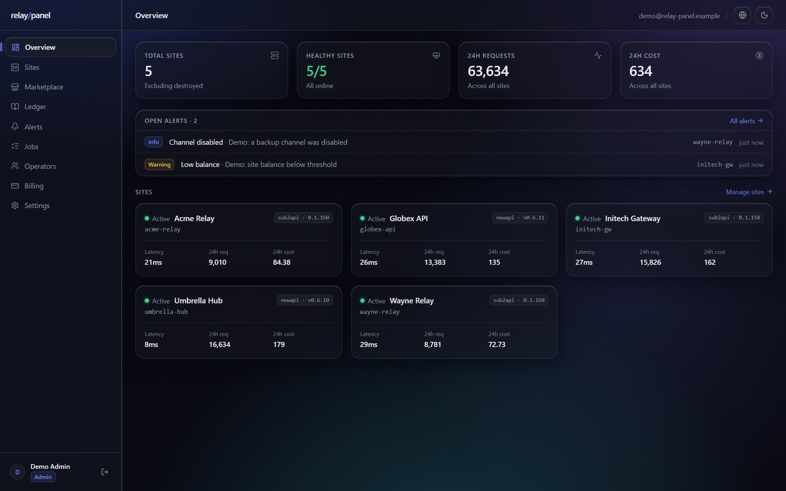
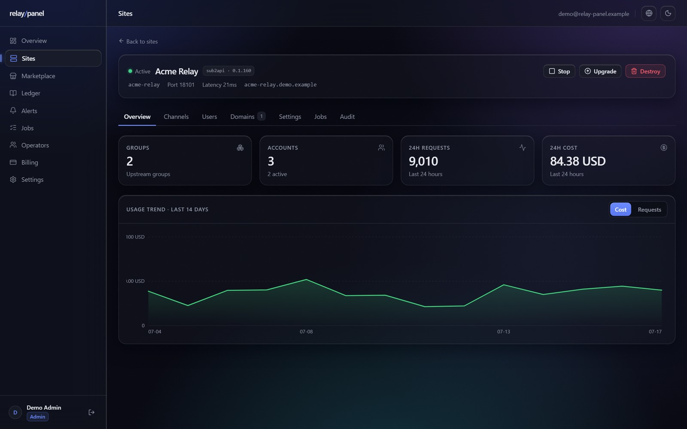
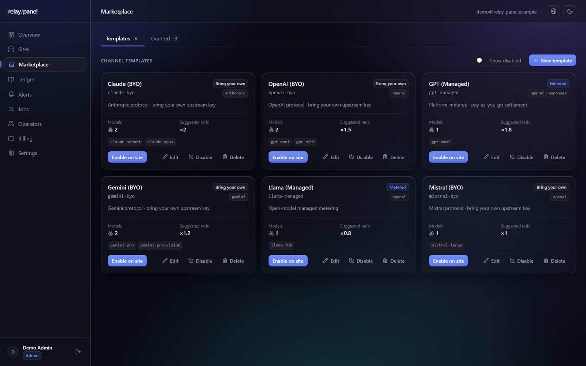
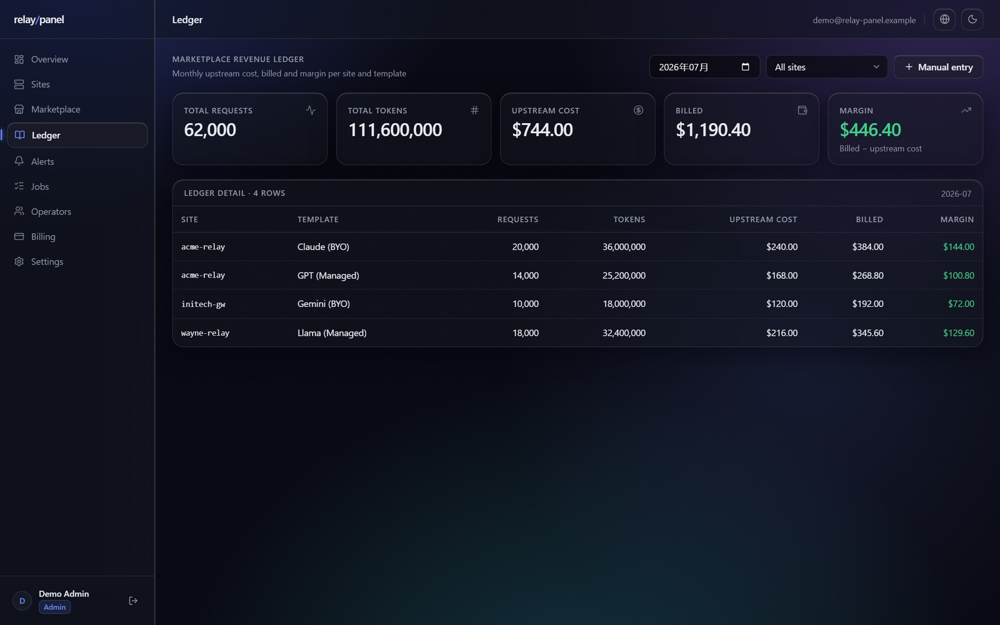
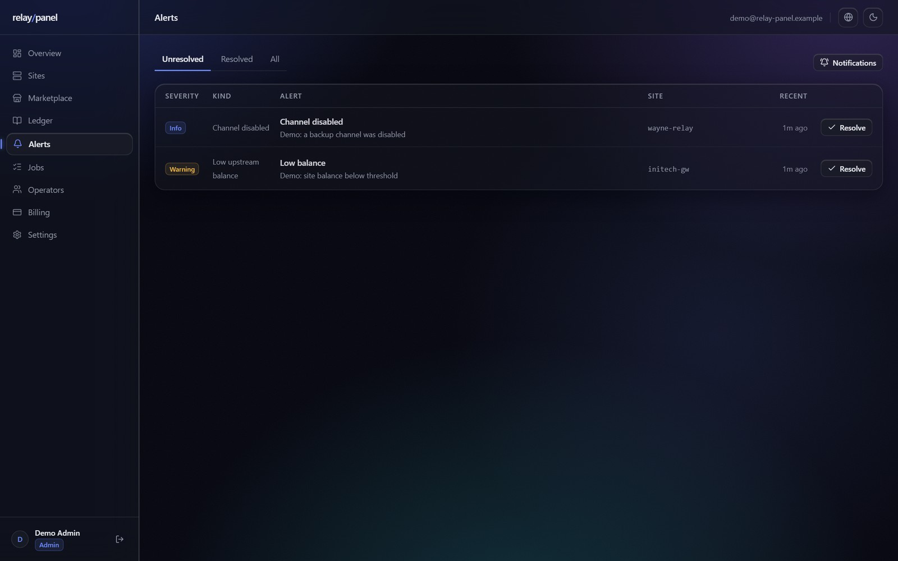
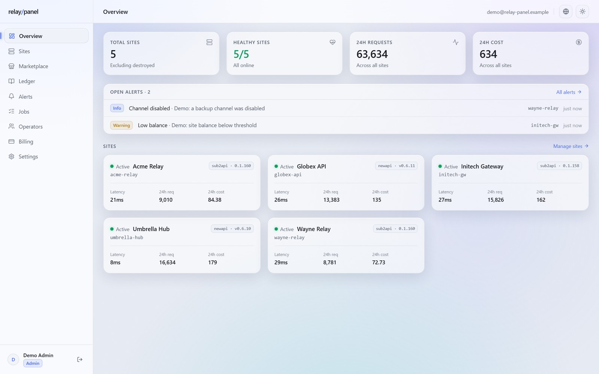
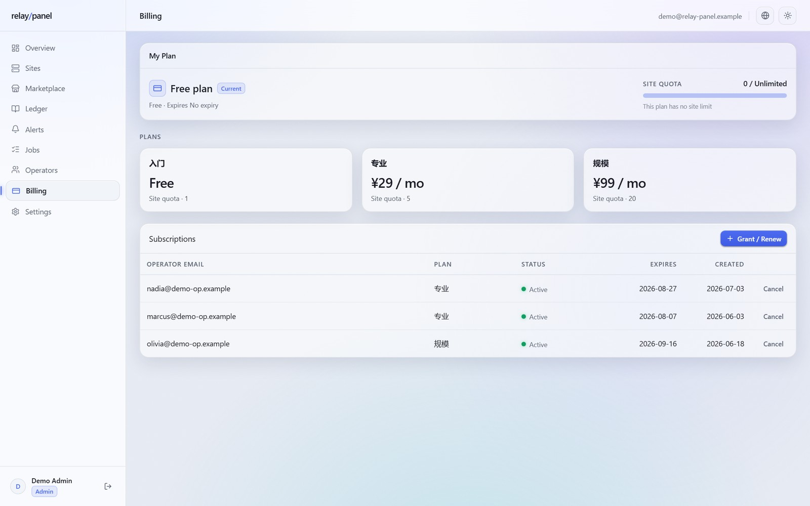

<div align="center">

# relay-panel

**One control plane for many LLM API relay stations.**

Connect, manage, and monitor any number of self-hosted [sub2api](https://github.com/Wei-Shaw/sub2api) / [new-api](https://github.com/QuantumNous/new-api) instances — engines stay unmodified, everything is driven from a single panel.

[](LICENSE)
[](https://nodejs.org)
[](https://www.typescriptlang.org/)
[](https://demo.3api.pro)

**English** · [简体中文](README.zh-CN.md) — [**Live demo →**](https://demo.3api.pro)

<br/>



</div>

---

## Why

Running an API relay station on top of an open-source engine (sub2api / new-api) has a low barrier: get upstream channels, deploy the engine, set your markup, done. But **running several of them** — different brands, different audiences, different domains — turns into repetitive manual work: deploy, upgrade, configure, fail over, all multiplied by every instance and every engine release.

relay-panel collapses that into one control plane:

```
┌───────────────────── relay-panel (control plane) ─────────────────────┐
│  web admin (Vue SPA) · auth / RBAC / audit · job engine · alerts      │
│  site lifecycle · channel marketplace + ledger · billing · domains    │
├───────────────────────── engine adapter layer ────────────────────────┤
│         sub2api adapter          │          new-api adapter           │
├───────────────────── data plane (isolated per site) ──────────────────┤
│   site A: sub2api + PG   │   site B: new-api + DB   │       …         │
└───────────────────────────────────────────────────────────────────────┘
```

## v2.7.0: Passive budgets and threshold alerts

Track daily, weekly and monthly budgets from existing consumption logs, scoped to a site, channel or model. Reports distinguish missing amounts, scan coverage and observed threshold crossings. Versioned events, optional owner notifications, one-time review notes and daily CSV exports preserve the evidence. These policies never probe models, stop channels, change balances or enforce engine limits.

## v2.6.0: Customer knowledge and model capability records

Publish setup guides, FAQs, runbooks and model capability records from a site-scoped knowledge workspace. Drafts and immutable history remain private; owners preview and publish a separate snapshot, restore old versions as new drafts, or revoke public access. Model support requires dated human evidence, with untested capabilities shown as unknown; the panel sends no inference probes.

## v2.5.0: Case-scoped collaboration

The collaboration workspace adds email-bound, single-use invitations for suppliers, resellers, operations, support and finance. Owners explicitly share a separate title and brief for eligible cases. Collaborators can reply and submit results for owner review; internal evidence, costs, credentials and workspace permissions are not inherited. Access expires within 90 days and can be revoked immediately. Invitees need an existing account with a verified email; invitation links are copied manually, not emailed automatically.

## v2.4.0: Site service center

Read existing Sub2API and New API logs to connect channel/model observations, cost signals, incidents, support tickets, partners and operational delivery. No synthetic inference calls or channel heartbeat probes are generated. Coverage, sample limits and freshness are explicit; absent traffic and missing fields remain unknown.

Includes scoped evidence exports, eight case workflows with checklists and progress history, supplier/reseller/operator records, client configuration examples and previewed public status notices. Collection can be paused per site. Partner records grant no implicit external access, and settlements never transfer funds automatically.

[Service guide](docs/SERVICE-CENTER.md) · [Planning and review record](docs/SERVICE-PLATFORM-PLAN.md) · [Release notes](docs/releases/v2.4.0.md)

## Features

- **Your infrastructure** — install engines on your own machine through the self-hosted panel, or connect existing sites. SaaS provides panel management, not relay hardware or server rental. Existing locally managed installations retain lifecycle support.
- **Web admin backend** — Vue 3 SPA: fleet overview, per-site drill-down (channels / users / usage / domains / audit), job timelines. Liquid-glass UI with light/dark themes and **10-language i18n** (English / 中文 / 日本語 / 한국어 / Français / Deutsch / Español / Português / Italiano / Bahasa Indonesia).
- **Multi-engine, zero modification** — sub2api and new-api behind one adapter interface; engines always run official releases.
- **Channel marketplace** — upstream channel templates, one-click injection into any site (bring-your-own upstream, or managed keys issued by a metering gateway), with a usage/settlement ledger.
- **Alerting** — site down / job failed / channel disabled / low balance, plus low-margin and cost-spike signals, delivered by email or webhook when configured.
- **Multi-tenant RBAC** — site ownership per operator, open/invite signup, session auth, and write auditing. Root manages the platform; viewer is a platform-wide read-only role, not an organization member.
- **Billing & quotas** — self-serve Alipay / WeChat Pay / USDT checkout, recoverable payment fulfillment, prorated upgrades, and downgrades at the current term boundary.
- **Domain automation** — bind a domain in the panel, routes are pushed to Caddy's admin API, TLS is automatic.
- **Observability** — Prometheus `/metrics`, health probes, structured audit log.
- **Backup / restore** — one command dumps orchestrator state plus every site's database.
- **One-command deploy** — `docker compose up -d` from `deploy/`.

## v2.2.0 highlights

[Release notes](docs/releases/v2.2.0.md)

- Separate operator workspaces and grouped administrator tools, with mobile navigation.
- Connect existing sites with an automatically assigned internal ID and an editable nickname.
- Payment recovery and frozen plan-change quotes; finance totals disclose missing data and separate consumption charges, supplier costs, and cash top-ups.
- Administrator request-level financial review with evidence, deduplication, decision notes, and rechecks. See [billing](docs/BILLING.md) and [financial review](docs/FINANCE-REVIEW.md).

**An anonymized operational example:** a low-margin warning email prompted an investigation that confirmed repeated exploitation of a settlement flaw in an older Sub2API deployment: upstream usage incurred costs while customer charges were not committed. The alert helped identify the issue and drive an engine upgrade; the [upstream fix](https://github.com/Wei-Shaw/sub2api/commit/c2d5bbd93edfb3a14f7da28d2e62c9216f0bbc86) addresses the defect. Sites, accounts, amounts, and private logs are omitted. relay-panel provides monitoring and review; engine fixes are deployed separately.

## Screenshots

> Try it live at **[demo.3api.pro](https://demo.3api.pro)** — read-only demo, sample data, resets periodically.

<table>
<tr>
<td width="50%"><br/><sub>Per-site drill-down — channels, users, usage trends, domains, audit</sub></td>
<td width="50%"><br/><sub>Channel marketplace — templates, grants, settlement</sub></td>
</tr>
<tr>
<td width="50%"><br/><sub>Settlement ledger — usage, upstream cost, margin</sub></td>
<td width="50%"><br/><sub>Alerting — site down / job failed / channel disabled / low balance</sub></td>
</tr>
<tr>
<td width="50%"><br/><sub>Light theme</sub></td>
<td width="50%"><br/><sub>Billing &amp; quotas · plans and subscriptions</sub></td>
</tr>
</table>

## Hosted or self-hosted

**Two ways to run relay-panel — same codebase, your choice of whose server runs it.**

| | Hosted SaaS | Self-hosted |
|---|---|---|
| Get started | Sign up at **[panel.3api.pro](https://panel.3api.pro)** — connect your own servers | `docker compose up -d` from [`deploy/`](deploy/) |
| Panel runs on | Our infrastructure | Yours |
| You manage | Your relay servers, engines and backups | The panel + your relay servers |
| Best for | Ship fast, connect existing stations, pay as you grow | Full control, air-gapped, or your own SaaS |

- **Try before anything** → [demo.3api.pro](https://demo.3api.pro) (read-only, sample data).
- **Hosted panel**: connect your own Sub2API / New API instances. Plans cover management and site quotas; they do not include hardware, upstream usage, engine hosting or engine backups.
- **Self-hosted**: one command brings up the full stack; the [self-host guide](docs/SELF-HOST.md) covers reverse proxy, backups, and metering.

## SaaS operations

Account verification and recovery, authenticator MFA/recovery codes, session revocation, team workspaces, notification preferences, support tickets, reviewed refunds and statements, scheduled panel backups, audit export, and supplier invoice reconciliation are available. See [the operating guide](docs/SAAS-OPERATIONS.md) for configuration, limits and acceptance evidence. Refund completion records a verified provider receipt; it does not automatically transfer money.

## Core principles

1. **Engines are never modified.** sub2api / new-api always run their official releases. All added value lives in the orchestration layer and is applied through each engine's own admin API. This keeps upgrades cheap and licensing clean (see [docs/LICENSE-COMPLIANCE.md](docs/LICENSE-COMPLIANCE.md)).
2. **One isolated instance per site.** No shared multi-tenancy at the data layer — clean isolation, independent upgrades, and any site can be exported as a stock engine instance at any time.
3. **Hosted and self-hosted share one codebase.** SaaS disables server provisioning; self-hosting includes local application installation and environment/lifecycle management.

## Quick start

```bash
git clone https://github.com/3api-pro/relay-panel.git
cd relay-panel/deploy
cp .env.example .env   # set RP_SECRET_KEY, RP_ADMIN_EMAIL, RP_ADMIN_PASSWORD
docker compose up -d
```

Then open `http://<server>:7100` and log in. Full guide (env reference, reverse proxy, upgrades, backups, migration from the old Basic-Auth setup): **[docs/SELF-HOST.md](docs/SELF-HOST.md)**.

For development:

```bash
npm install
npm run typecheck
npm test
```

## Documentation

| Doc | Contents |
|---|---|
| [docs/SELF-HOST.md](docs/SELF-HOST.md) | Deploy, configure, upgrade, back up |
| [docs/API.md](docs/API.md) | Full HTTP API reference |
| [docs/ADAPTERS.md](docs/ADAPTERS.md) | Adapter interfaces + how to add a new engine |
| [docs/OPERATIONS.md](docs/OPERATIONS.md) | Monitoring, alerting, backup/restore, troubleshooting |
| [docs/SECURITY.md](docs/SECURITY.md) | Threat model, credential encryption, RBAC, disclosure |
| [docs/METERING-GATEWAY.md](docs/METERING-GATEWAY.md) | HTTP contract for the managed-marketplace metering gateway |
| [docs/CADDY.md](docs/CADDY.md) | Domain automation with Caddy |
| [docs/ARCHITECTURE.md](docs/ARCHITECTURE.md) | Design and rationale |

## Architecture

- **`packages/adapter-core`** — engine-agnostic domain types + the `EngineAdapter` / `EngineLifecycle` interfaces.
- **`packages/adapter-sub2api`** / **`packages/adapter-newapi`** — engine implementations (admin auth, channels/groups/users/settings/usage).
- **`packages/orchestrator`** — Fastify + Drizzle control plane: sites, jobs, auth/RBAC, marketplace + ledger, alerts, billing, domains, metrics, CLI.
- **`packages/web`** — Vue 3 + Vite + Tailwind admin SPA.

## Status & roadmap

This is a v2 rewrite; it is **not** compatible with the original relay-panel (a self-built relay engine), which is preserved on the [`legacy`](https://github.com/3api-pro/relay-panel/tree/legacy) branch.

- [x] **P1 — Fleet manager:** orchestrator + sub2api adapter + site lifecycle + read-only unified dashboard
- [x] **P2 — More engines + channel marketplace:** new-api adapter; channel templates, grants, metering/settlement ledger
- [x] **P3 — Admin backend:** operator accounts + RBAC, full write UI, alerting, one-command Docker deployment
- [ ] **P4 — Hosted SaaS acceptance:** the seven core capabilities are implemented, including payments and site adoption. End-to-end delivery and operational acceptance remain open; see the [current readiness assessment](docs/P4-READINESS.md).

Milestone scope and acceptance criteria: [ROADMAP.md](ROADMAP.md).

## Sponsors

relay-panel's development is backed by these LLM API relay platforms — production users of the engines this project orchestrates:

<table align="center">
<tr><td align="center" width="520">
<a href="https://llmapi.pro"><b>llmapi.pro</b></a> — Unified multi-model LLM API · Claude · GPT · Gemini and more
</td></tr>
<tr><td align="center" width="520">
<a href="https://tieapi.com"><b>tieapi.com</b></a> — High-availability API gateway for teams and developers
</td></tr>
<tr><td align="center" width="520">
<a href="https://vipapi.ai"><b>vipapi.ai</b></a> — Premium LLM API access with flexible plans
</td></tr>
</table>

Interested in sponsoring? Open an [issue](https://github.com/3api-pro/relay-panel/issues).

## Contributing

See [CONTRIBUTING.md](CONTRIBUTING.md). The **engine adapter layer (`packages/adapter-*`) is the recommended entry point** for outside contributors — it contains no billing, upstream-routing, or credential logic, is self-contained and independently testable, and breaking it cannot touch production billing or tenant isolation. Want to bring a new engine? Follow [docs/ADAPTERS.md](docs/ADAPTERS.md).

## License

MIT for the orchestrator itself (see [LICENSE](LICENSE)). Orchestrated engines keep their own licenses — new-api ([AGPL-3.0](https://github.com/QuantumNous/new-api)), sub2api ([LGPL-3.0](https://github.com/Wei-Shaw/sub2api)); relay-panel invokes them only through their public admin APIs and never bundles or modifies them.
